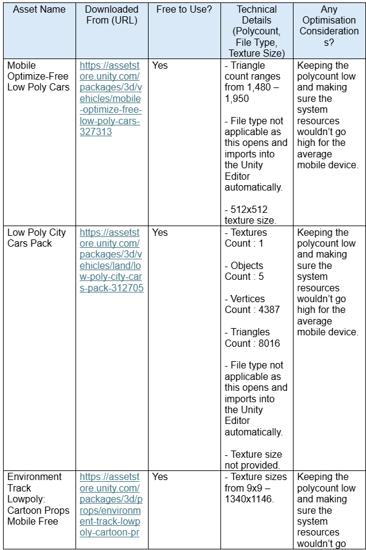
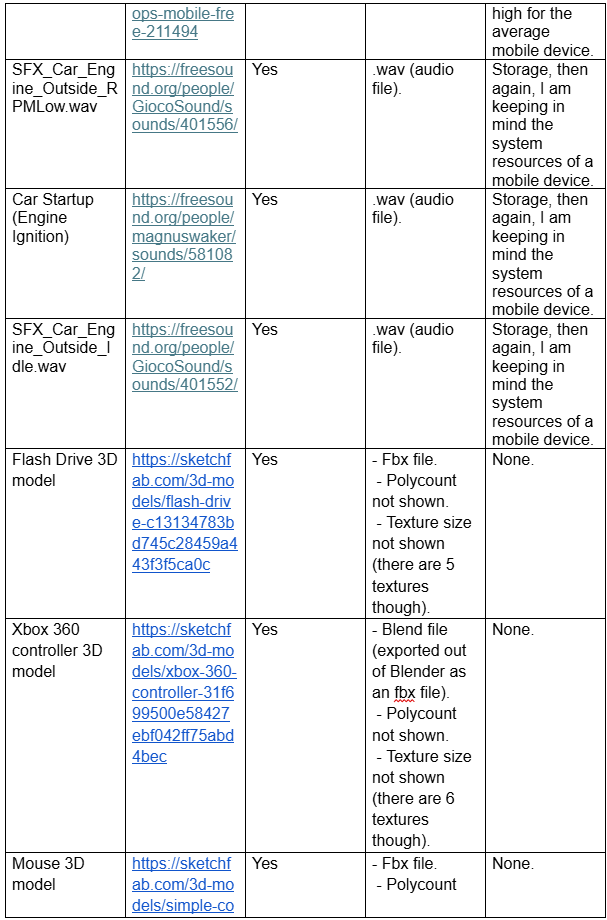
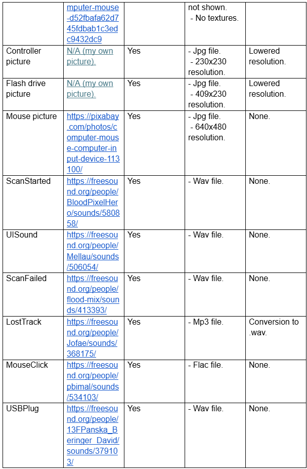
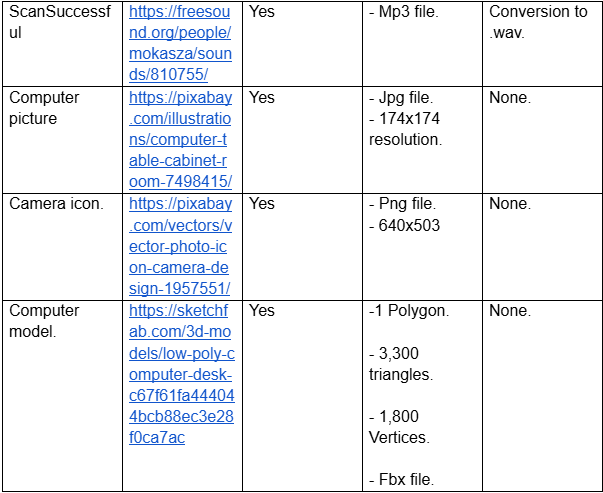

<h1>AR Learning</h1>
<!-- Scanned object screenshot not yet added. -->

<b>AR Learning</b> is an offline Augmented Reality identifying app for Android smartphones. It has similiar functionality to Google Lens, but instead of requiring access to the Internet and searching names of identified objects online, my AR Learning app identifies the object locally and tells you what it is and what you can use it for.

That isn't just it though, my app also has the following features:

<ul>
  <li>Testing yourself on a scanned object with a quiz (the mouse).</li>
  <li>Videos on scanned objects (the computer).</li>
  <li>3D object rotation (applied to all objects, but only works on the controller due to a bug).</li>
</ul>

My research, planning, development, evaluation and reflective log for my AR Learning app are on my Wix website for it at: https://s3017235.wixsite.com/term-2.

 
<h2>How do I run this app on my smartphone?</h2>

Personally, I wouldn't as the app is very limited (it only works for scanning the images in: Assets > Images), I would suggest the Unity Editor but my app was built using version 6000.0.38f1 of that software, which has a publically known vulnerability that affects built projects (I still don't recommend running it in the Editor), you can read about it at: https://unity.com/security/sept-2025-01. I take no responsibility for any damages (including malware and data loss) if you decide to clone this repository and run/build my app with a vulnerable version of Unity Editor.

At some point, I will try my app in a newer version of the Unity Editor and if it works properly, then I'll update this repository to the newer version. I'll also upload an APK of my app, I unfortunately can't build nor test on iOS as I don't have a Mac, but keep in mind that this also means I have only tested my app on Android, so don't expect it to work correctly if you build to iOS yourself.

Running the app in the Editor is the best way to try it out as the only 4 images it can scan are included in a virtual room, meaning that you won't have to manually open or print the pictures out to scan them. If you haven't used Augmented Reality in the Unity Editor before, learning how to use it for my app is straightforward, except that you have to hold down right click to look around and move using WASD.

 
<h2>Asset table</h2>
</img>
</img>
</img>
</img>

 
<h2>Note about the above links</h2>

This README file was last updated on the 28th of October 2026, if any links above aren't working, then they may have been taken down (though my website I made should still be fine if Wix still exists). I did create my Wix account using my College email address, but I'll change it to my personal one before I leave College.

